# Poly Haven: Brick & Block textures

**36 assets from [Poly Haven](https://polyhaven.com), dedicated to the public domain under [CC0](https://polyhaven.com/license).** Use them in any game, free or paid, and change them however you like; no credit is needed.

PBR textures as 1K and 2K JPG maps (colour, normal (GL and DX), roughness, AO, displacement and more). 896.4 MB in all.

This is a copy kept by [zuujis-cc0](https://github.com/zuujis-cc0) so game makers can take single files from GitHub. It is not made by or affiliated with Poly Haven: the originals, often in more formats and higher resolutions, are on [polyhaven.com](https://polyhaven.com). If they help you, consider [supporting Poly Haven](https://www.patreon.com/polyhaven/overview).

Every file is listed in [MANIFEST.tsv](MANIFEST.tsv) with its size and SHA-256. More free assets: [the Zuujis collection](https://github.com/zuujis-cc0/free-game-assets#readme).

| | | | |
| :-: | :-: | :-: | :-: |
| <a href="large_sandstone_blocks_01">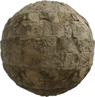</a> <b><a href="large_sandstone_blocks_01">Large Sandstone Blocks 01</a></b> by Rob Tuytel · <a href="https://polyhaven.com/a/large_sandstone_blocks_01">source</a> | <a href="large_square_pattern_01">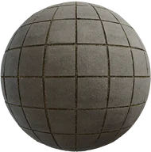</a> <b><a href="large_square_pattern_01">Large Square Pattern 01</a></b> by Rob Tuytel · <a href="https://polyhaven.com/a/large_square_pattern_01">source</a> | <a href="medieval_blocks_02">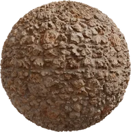</a> <b><a href="medieval_blocks_02">Medieval Blocks 02</a></b> by Rob Tuytel · <a href="https://polyhaven.com/a/medieval_blocks_02">source</a> | <a href="medieval_blocks_03">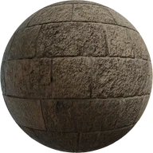</a> <b><a href="medieval_blocks_03">Medieval Blocks 03</a></b> by Rob Tuytel · <a href="https://polyhaven.com/a/medieval_blocks_03">source</a> |
| <a href="medieval_blocks_06">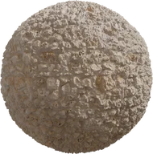</a> <b><a href="medieval_blocks_06">Medieval Blocks 06</a></b> by Rob Tuytel · <a href="https://polyhaven.com/a/medieval_blocks_06">source</a> | <a href="medieval_red_brick">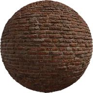</a> <b><a href="medieval_red_brick">Medieval Red Brick</a></b> by Rob Tuytel · <a href="https://polyhaven.com/a/medieval_red_brick">source</a> | <a href="mixed_brick_wall">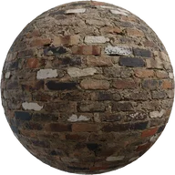</a> <b><a href="mixed_brick_wall">Mixed Brick Wall</a></b> by Dimitrios Savva · <a href="https://polyhaven.com/a/mixed_brick_wall">source</a> | <a href="mossy_brick">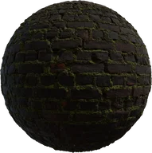</a> <b><a href="mossy_brick">Mossy Brick</a></b> by Amal Kumar · <a href="https://polyhaven.com/a/mossy_brick">source</a> |
| <a href="mossy_brick_floor">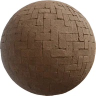</a> <b><a href="mossy_brick_floor">Mossy Brick Floor</a></b> by Charlotte Baglioni · <a href="https://polyhaven.com/a/mossy_brick_floor">source</a> | <a href="mossy_sandstone">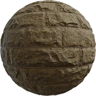</a> <b><a href="mossy_sandstone">Mossy Sandstone</a></b> by Dimitrios Savva · <a href="https://polyhaven.com/a/mossy_sandstone">source</a> | <a href="old_sandstone_02">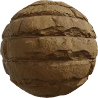</a> <b><a href="old_sandstone_02">Old Sandstone 02</a></b> by Dimitrios Savva · <a href="https://polyhaven.com/a/old_sandstone_02">source</a> | <a href="overgrown_concrete_pavers">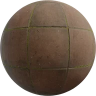</a> <b><a href="overgrown_concrete_pavers">Overgrown Concrete Pavers</a></b> by Dimitrios Savva · <a href="https://polyhaven.com/a/overgrown_concrete_pavers">source</a> |
| <a href="painted_brick">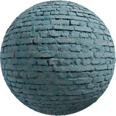</a> <b><a href="painted_brick">Painted Brick</a></b> by Amal Kumar · <a href="https://polyhaven.com/a/painted_brick">source</a> | <a href="painted_worn_brick">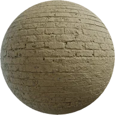</a> <b><a href="painted_worn_brick">Painted Worn Brick</a></b> by Dimitrios Savva · <a href="https://polyhaven.com/a/painted_worn_brick">source</a> | <a href="patterned_brick_floor">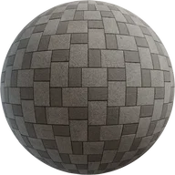</a> <b><a href="patterned_brick_floor">Patterned Brick Floor</a></b> by Charlotte Baglioni · <a href="https://polyhaven.com/a/patterned_brick_floor">source</a> | <a href="patterned_brick_floor_02">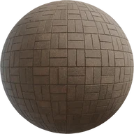</a> <b><a href="patterned_brick_floor_02">Patterned Brick Floor 02</a></b> by Charlotte Baglioni · <a href="https://polyhaven.com/a/patterned_brick_floor_02">source</a> |
| <a href="patterned_brick_floor_03">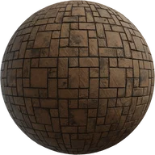</a> <b><a href="patterned_brick_floor_03">Patterned Brick Floor 03</a></b> by Dimitrios Savva · <a href="https://polyhaven.com/a/patterned_brick_floor_03">source</a> | <a href="patterned_brick_wall">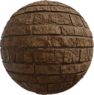</a> <b><a href="patterned_brick_wall">Patterned Brick Wall</a></b> by Dario Barresi, Dimitrios Savva · <a href="https://polyhaven.com/a/patterned_brick_wall">source</a> | <a href="patterned_brick_wall_02">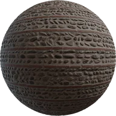</a> <b><a href="patterned_brick_wall_02">Patterned Brick Wall 02</a></b> by Charlotte Baglioni, Dario Barresi · <a href="https://polyhaven.com/a/patterned_brick_wall_02">source</a> | <a href="patterned_brick_wall_03">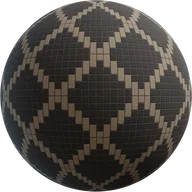</a> <b><a href="patterned_brick_wall_03">Patterned Brick Wall 03</a></b> by Charlotte Baglioni · <a href="https://polyhaven.com/a/patterned_brick_wall_03">source</a> |
| <a href="patterned_concrete_pavers">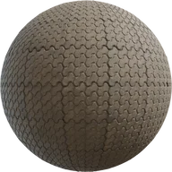</a> <b><a href="patterned_concrete_pavers">Patterned Concrete Pavers</a></b> by Amal Kumar · <a href="https://polyhaven.com/a/patterned_concrete_pavers">source</a> | <a href="patterned_concrete_pavers_02">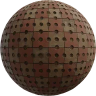</a> <b><a href="patterned_concrete_pavers_02">Patterned Concrete Pavers 02</a></b> by Amal Kumar · <a href="https://polyhaven.com/a/patterned_concrete_pavers_02">source</a> | <a href="patterned_concrete_wall">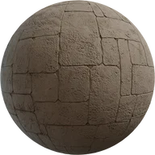</a> <b><a href="patterned_concrete_wall">Patterned Concrete Wall</a></b> by Dimitrios Savva · <a href="https://polyhaven.com/a/patterned_concrete_wall">source</a> | <a href="pavement_02">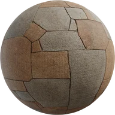</a> <b><a href="pavement_02">Pavement 02</a></b> by Charlotte Baglioni, Dario Barresi · <a href="https://polyhaven.com/a/pavement_02">source</a> |
| <a href="pavement_03">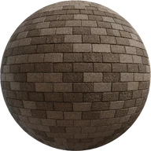</a> <b><a href="pavement_03">Pavement 03</a></b> by Charlotte Baglioni, Dario Barresi · <a href="https://polyhaven.com/a/pavement_03">source</a> | <a href="pavement_04">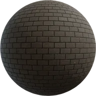</a> <b><a href="pavement_04">Pavement 04</a></b> by Jan Burghardt · <a href="https://polyhaven.com/a/pavement_04">source</a> | <a href="pavement_06">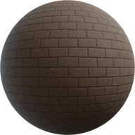</a> <b><a href="pavement_06">Pavement 06</a></b> by Jan Martens · <a href="https://polyhaven.com/a/pavement_06">source</a> | <a href="pebble_bricks">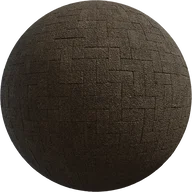</a> <b><a href="pebble_bricks">Pebble Bricks</a></b> by Dimitrios Savva · <a href="https://polyhaven.com/a/pebble_bricks">source</a> |
| <a href="pebble_embedded_concrete_02">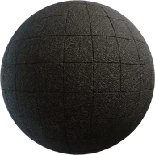</a> <b><a href="pebble_embedded_concrete_02">Pebble Embedded Concrete 02</a></b> by Charlotte Baglioni · <a href="https://polyhaven.com/a/pebble_embedded_concrete_02">source</a> | <a href="precast_stone_paving">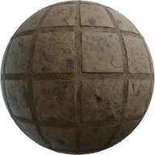</a> <b><a href="precast_stone_paving">Precast Stone Paving</a></b> by Dimitrios Savva · <a href="https://polyhaven.com/a/precast_stone_paving">source</a> | <a href="random_bricks_thick">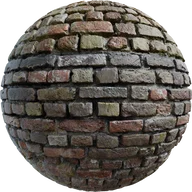</a> <b><a href="random_bricks_thick">Random Bricks Thick</a></b> by Rob Tuytel · <a href="https://polyhaven.com/a/random_bricks_thick">source</a> |  <b><a href="rectangular_facade_tiles">Rectangular Facade Tiles</a></b> by Charlotte Baglioni · <a href="https://polyhaven.com/a/rectangular_facade_tiles">source</a> |
| <a href="rectangular_facade_tiles_02">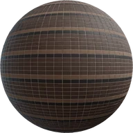</a> <b><a href="rectangular_facade_tiles_02">Rectangular Facade Tiles 02</a></b> by Charlotte Baglioni · <a href="https://polyhaven.com/a/rectangular_facade_tiles_02">source</a> | <a href="recycled_brick_floor">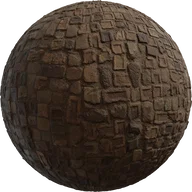</a> <b><a href="recycled_brick_floor">Recycled Brick Floor</a></b> by Dimitrios Savva · <a href="https://polyhaven.com/a/recycled_brick_floor">source</a> | <a href="red_brick">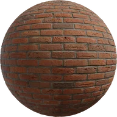</a> <b><a href="red_brick">Red Brick</a></b> by Rob Tuytel · <a href="https://polyhaven.com/a/red_brick">source</a> | <a href="red_brick_03">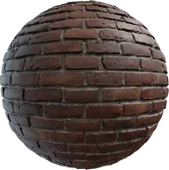</a> <b><a href="red_brick_03">Red Brick 03</a></b> by Rob Tuytel · <a href="https://polyhaven.com/a/red_brick_03">source</a> |

---

Kept up to date by this repository's own [update workflow](.github/workflows/update.yml), with code and plan from [cc0-mirror](https://github.com/zuujis-cc0/cc0-mirror). Something wrong? [Open an issue there](https://github.com/zuujis-cc0/cc0-mirror/issues/new) or use the [private report form](https://games.zuujis.com/report).
